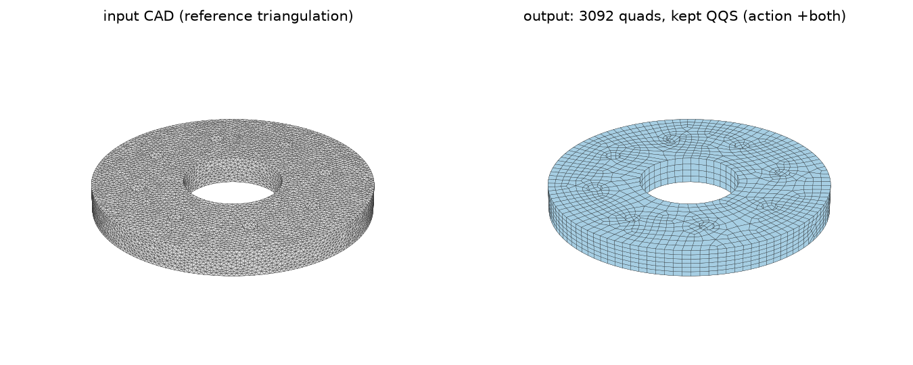
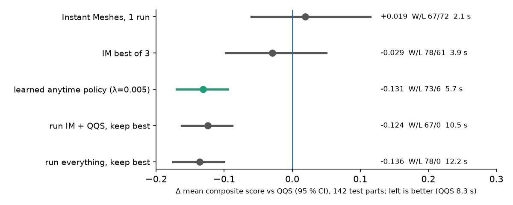

# Learned Anytime Policy for Quad Meshing of CAD Solids

A small learned controller decides, per CAD part, which mesher runs are worth their time. It beats Gmsh's
quasi-structured quad mesher (QQS) on a leakage-free benchmark at an equal element budget, in less wall time.


*Input CAD part (left, reference triangulation) and the quad mesh kept by the policy (right). Made by
`scripts/make_figures.py` with `scripts/infer.py` on the generated test part `cad_models/flange_06`.*

## Key results

Frozen test set (142 CAD parts from ABC, a second public CAD collection and parametric parts; families never shared with
training) and an out-of-distribution set (39 HexMe parts, a different source never used for training or tuning).
Every method gets the **same element budget** n* per part: the quad count Gmsh QQS realises on that part.

Score = pre-registered composite a-priori quality (lower is better; no simulation involved):
`irregular_frac + bad_frac + 0.5·(1 − SJ_p05) + 10·Hausdorff/diag + 10·feature_dist/diag`, failure = 10.
Δ = paired mean difference vs QQS, 95 % bootstrap CI (10,000 resamples over parts); W/L = parts better/worse
than QQS by more than 0.005; time = mean wall seconds per part.

**In-distribution test (142 parts)**

| method | mean | median | Δ vs QQS [95 % CI] | W/L | time |
|---|---|---|---|---|---|
| Gmsh QQS (Reberol et al. 2021), reference | 0.3760 | 0.3062 | – | – | 8.35 s |
| Instant Meshes (Jakob et al. 2015), budget-matched, 1 run | 0.3954 | 0.2992 | +0.0194 [−0.0598, +0.1145] | 67/72 | 2.11 s |
| Instant Meshes, best of 3 size perturbations | 0.3467 | 0.2698 | −0.0293 [−0.0980, +0.0502] | 78/61 | 3.85 s |
| ML probe cascade (QQS on 30 % of parts) — ablation | 0.2707 | 0.2643 | −0.1053 [−0.1456, −0.0670] | 67/31 | 3.10 s |
| two-stage ML routing (2nd mesher on 30 %) — ablation | 0.2628 | 0.2338 | −0.1132 [−0.1520, −0.0765] | 58/6 | 3.89 s |
| **learned anytime policy, λ = 0.005 (chosen on val)** | **0.2451** | **0.2306** | **−0.1309 [−0.1702, −0.0944]** | **73/6** | **5.66 s** |
| learned anytime policy, λ = 0.02 (faster setting) | 0.2608 | 0.2479 | −0.1152 [−0.1548, −0.0778] | 71/24 | 3.41 s |
| upper bound: run IM ×3 + QQS, keep best | 0.2396 | 0.2282 | −0.1364 [−0.1753, −0.1001] | 78/0 | 12.20 s |

Sign test for the val-chosen policy: p = 1.0e-15. It captures 96 % of the run-everything gain in 46 % of its time.

**Out of distribution, HexMe (39 parts)**

| method | mean | Δ vs QQS [95 % CI] | W/L | time |
|---|---|---|---|---|
| Gmsh QQS, reference | 0.2767 | – | – | 3.91 s |
| Instant Meshes, budget-matched, 1 run | 0.3062 | +0.0294 [−0.0168, +0.0699] | 9/29 | 1.94 s |
| **learned anytime policy, λ = 0.005** | **0.2327** | **−0.0441 [−0.0912, −0.0079]** | **13/4** | 5.41 s |
| upper bound: run everything, keep best | 0.2262 | −0.0505 [−0.0968, −0.0147] | 15/0 | 7.41 s |

On HexMe the policy still beats QQS (sign test p = 0.049, borderline) but is **slower** than QQS, which is fast on
these parts.

**Classical baseline we also built** (all 150 test parts; failures count as 10, so means are higher than above):
selecting the best of 9 QQS runs (4 size perturbations + 5 sizing fields) by the same a-priori score gives
Δ −0.1202 [−0.1471, −0.0951], 116 better / 0 worse, at the cost of 9 QQS runs per part (`results/logs/baselines_test.md`).



**Settings.** Gmsh 4.15.2 (QQS = `Mesh.Algorithm 11`, Blossom = algorithm 8 + recombination), patched
Instant Meshes, scikit-learn 1.9.1. Times are single-thread (`OMP_NUM_THREADS=1`) on a laptop with an Intel Core
i7-8750H (2.2 GHz) and 16 GB RAM, Windows 11, Python 3.12. QQS time is half of its two-pass budget-matching run;
the extra-IM time is half of the measured 3-run time.

**No commercial mesher was benchmarked** (no ANSYS / HyperMesh / Simcenter numbers). QQS is the strongest open
classical quad mesher we found; Blossom results are in the label files and `results/logs/baselines_test.md`.

**Trade-off you should know about.** The policy's gain comes mostly from element quality; CAD fidelity gets worse
because Instant Meshes cannot place edges exactly on sharp CAD features. Mean components over the 142 test parts
(`results/logs/anytime_test.log`, last lines):

| | irregular | bad quads (SJ < 0.3) | SJ p05 ↑ | Hausdorff / diag | feature dist / diag |
|---|---|---|---|---|---|
| QQS | 0.0419 | 0.0475 | 0.547 | 0.0057 | 0.00031 |
| learned policy | 0.0269 | 0.0068 | 0.802 | 0.0094 | 0.00185 |

If CAD fidelity matters more than element shape for you, the composite weights favour QQS more and the advantage
shrinks.

## Method

<!-- TODO: replace with a method diagram (results/figures/method_diagram.png) -->
```
CAD part ──► shape descriptor (15-D) ─────────────────────┐
    │                                                     ▼
    └──► Instant Meshes probe (IM1) ──► IM1 metrics ──► 4 GBM value models ──► argmin(score + λ·time)
                                                                                   │
              stop │ +2 IM runs │ +QQS │ +both  ◄─────────────────────────────────┘
                                   ▼
                     keep the attempt with the best a-priori score
```

1. **Probe.** Mesh the part once with budget-matched Instant Meshes (IM1, about 2 s).
2. **Features.** 15-D scale-invariant shape descriptor of the CAD part (area share per surface type, face/edge
   counts, bounding-box ratios, area/volume ratios) + IM1's own a-priori metrics (irregular vertices, scaled
   Jacobian p05/mean, bad-quad fraction, Hausdorff, Chamfer, feature distance, quad fraction, validity, score).
3. **Value model.** One gradient-boosted regressor (`HistGradientBoostingRegressor`, depth 3, 300 iterations) per
   action predicts the final clipped score of {stop, +2 more IM runs, +QQS, +both}.
4. **Decision.** Pick `argmin(predicted score + λ · expected time)`. λ is the largest value whose validation mean
   is within 2 % of the best validation mean (λ* = 0.005). Test and OOD sets are evaluated once.
5. **Output.** Keep the attempt with the best a-priori score.

Why it works: neither mesher dominates (Instant Meshes alone is better than QQS on 67 test parts and worse on 72),
and QQS is *chaotic*: a 1-4 % change of target size can swing its quality a lot (`results/figures/qqs_chaos.png`).
Cheap extra attempts plus a learned choice of *which* attempt is worth its time beat any single run.

Trained on 648 training parts; training takes about 5 s on a laptop CPU.

## Installation

Python 3.12 (3.11+ should work).

```sh
python -m venv .venv
source .venv/bin/activate        # Windows: .venv\Scripts\activate
pip install -r requirements.txt
pip install -e .
```

Meshing with Instant Meshes (inference, re-labelling) also needs the patched `pyinstantmeshes`; build it as in
[third_party/pyinstantmeshes_patch/BUILD.md](third_party/pyinstantmeshes_patch/BUILD.md). Training, evaluation and
all reported numbers need only `requirements.txt`.

## Data preparation

The labels (per-part mesh metrics), descriptors and frozen split needed for every number above are in the repo
(`results/labels/`, `results/features/`, `configs/splits/v1.json`, about 6 MB). CAD files are only needed to re-mesh;
see [data/README.md](data/README.md) for the sources (ABC, SimJEB, HexMe, generated parts and one further CAD collection) and
set their local roots in `configs/data.toml`.

## Usage

```sh
# train the policy (TRAIN labels), choose lambda on VAL, save it
python scripts/train.py --out checkpoints/anytime_policy.joblib

# evaluate on the frozen test set / the HexMe OOD set (trains first if --model is omitted)
python scripts/eval.py --model checkpoints/anytime_policy.joblib
python scripts/eval.py --split ood

# mesh a CAD part (needs pyinstantmeshes); --target-quads sets the element budget (default 2500)
python scripts/infer.py --step part.step --model checkpoints/anytime_policy.joblib --out part_quads.obj

# ablations and baselines
python scripts/ablation_probe_cascade.py [--split ood]   # probe cascade, geometry-only gate, two-stage routing
python scripts/eval_baselines.py                          # QQS sizing fields, Blossom, QQS select-by-score

# regenerate data / labels / figures
python scripts/make_parametric_parts.py --out <cad_models root>
python scripts/make_labels.py --part test --methods qqs_default --out results/labels/my_test.jsonl
python scripts/make_labels.py --part test --methods im_matched,im_k3,gmsh_blossom --out results/labels/my_test.jsonl
python scripts/make_figures.py [--step part.step --model checkpoints/anytime_policy.joblib]
```

Every script has `--help`. The trained policy is about 1 MB; a pretrained file will be attached to the GitHub
release (**download link: TODO**). Retraining reproduces it exactly (fixed seeds, about 5 s).

## Reproducing the reported numbers

```sh
OMP_NUM_THREADS=1 python scripts/eval.py              > results/logs/anytime_test.log
OMP_NUM_THREADS=1 python scripts/eval.py --split ood  > results/logs/anytime_ood.log
python scripts/ablation_probe_cascade.py              > results/logs/probe_cascade_test.log
python scripts/ablation_probe_cascade.py --split ood  > results/logs/probe_cascade_ood.log
python scripts/eval_baselines.py --out results/logs/baselines_test.md
pytest -q tests/test_reproduce.py                      # asserts the headline numbers
```

These need no meshing and finish in a few minutes. Re-creating the labels themselves means meshing about 1,000 parts
with every method; that took many hours on the laptop above (2 worker processes).

**Where every number comes from**

| number(s) | file | line |
|---|---|---|
| test: QQS, IM 1 run, IM best of 3, run-everything, policy λ = 0.005 / 0.02, action mix | `results/logs/anytime_test.log` | `QQS alone`, `fixed: …`, `ML policy lam=…` |
| test: per-metric trade-off table | `results/logs/anytime_test.log` | `component means …` and the 2 lines after |
| OOD: QQS, IM, policy, run-everything | `results/logs/anytime_ood.log` | same labels |
| probe cascade (30 %), two-stage routing (30 %) | `results/logs/probe_cascade_test.log` | `ML probe cascade (QQS on 30%)`, `TWO-STAGE (2nd mesher on 30%)` |
| QQS select over 9 runs, Blossom, QQS sizing fields | `results/logs/baselines_test.md` | `select over all 9 QQS runs` etc. |
| "96 % of the gain in 46 % of the time" | `results/logs/anytime_test.log` | −0.1309 / −0.1364 and 5.66 s / 12.20 s |
| λ* = 0.005, validation sweep | `results/logs/anytime_test.log` | `val sweep …` |

Provenance note: the probe-cascade header reports 146 validation parts, whereas an earlier run of that script
printed 147; one validation label row changed after that run. Validation does not enter that script's test numbers,
which are identical between the two runs.

## Limitations and ongoing work

- **Fidelity vs quality.** Instant Meshes cannot snap edges to sharp CAD features, so policy meshes have larger
  Hausdorff and feature distances than QQS (table above). Feature-aware extraction would remove this trade-off.
- **Metric.** The composite weights were fixed before any learning experiment and never tuned, but they are a
  design choice; heavier fidelity weights favour QQS.
- **Budget.** n* is defined by QQS's own realised count. At inference QQS can overshoot the requested budget
  (e.g. 3,092 quads for a 2,500 target on `flange_06`).
- **Scope.** Quad *surface* meshes of single CAD solids, single-threaded laptop timings. No hexahedral meshing, no
  commercial mesher in the comparison, no simulation-based accuracy.
- **OOD speed.** On HexMe the policy is better than QQS but slower.
- **Negative results** (kept out of this repo): predicting good QQS sizing fields from geometry (deep sets, GBMs,
  DINOv2 multi-view embeddings) was no better than random because QQS is chaotic; learned singularity editing
  (Q-zip + ranker) tied QQS at 8× the time; layout-first submapping was 7× faster but worse on average.

Ongoing: feature-aware Instant Meshes extraction; more actions (QQS perturbations, sizing variants) in the policy.

## Citation

```bibtex
@software{anytime_quad_meshing_2026,
  author  = {ARJAMES13},
  title   = {Learned Anytime Policy for Quad Meshing of CAD Solids},
  year    = {2026},
  version = {1.0.0},
  url     = {https://github.com/ARJAMES13/anytime-quad-meshing}
}
```

## License

MIT (see [LICENSE](LICENSE)). Third-party tools keep their own licences: Gmsh (GPL-2.0+), Instant Meshes and
pyinstantmeshes (BSD-3-Clause), libigl (MPL-2.0). Datasets keep their own terms (see `data/README.md`).
